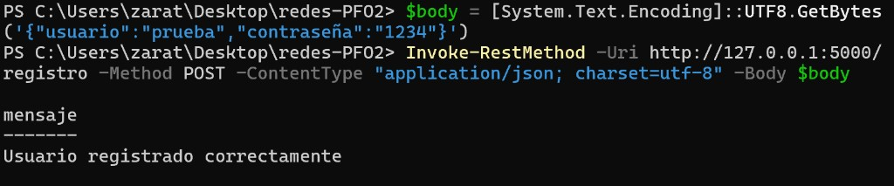
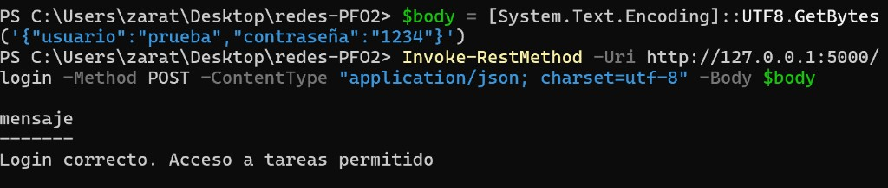
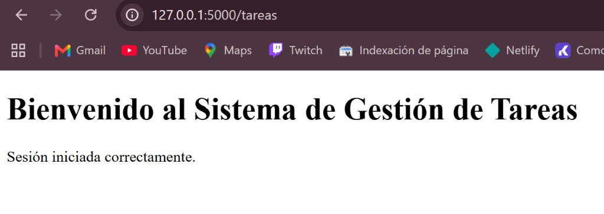

# Sistema de Gestión de Tareas con API y Base de Datos

- Repositorio: https://github.com/zarateCarlos/sistema-gestion-tareas-api-base-de-datos
- GitHub Pages: https://zaratecarlos.github.io/sistema-gestion-tareas-api-base-de-datos/

## Requisitos

- Python 3
- Dependencias: `pip install -r requirements.txt`

## Cómo ejecutar

Terminal 1 (servidor):

```bash
python servidor.py
```

Terminal 2 (cliente en consola):

```bash
python cliente.py
```

El servidor queda en http://127.0.0.1:5000

## Cómo probar

En el cliente:

1. Registrar usuario
2. Iniciar sesión
3. Ver tareas

También se puede abrir en el navegador: http://127.0.0.1:5000/tareas

## Capturas de pruebas exitosas

Las imágenes están en la carpeta `capturas/`.

### POST /registro



### POST /login



### GET /tareas



## Respuestas conceptuales

### ¿Por qué hashear contraseñas?

Si se guarda la contraseña en texto plano y alguien entra a la base de datos, puede leerla directo. Al hashearla se guarda un valor transformado que no se puede revertir fácilmente. En este proyecto uso `generate_password_hash` y `check_password_hash` de Werkzeug.

### Ventajas de usar SQLite en este proyecto

- No hace falta instalar un servidor de base de datos.
- Los datos se guardan en un archivo local.
- Es simple de usar con Python (`sqlite3`).
- Alcanza bien para un trabajo práctico chico.

## Archivos

- `servidor.py` - API Flask + SQLite
- `cliente.py` - cliente en consola
- `requirements.txt` - dependencias
- `capturas/` - capturas de pruebas exitosas
